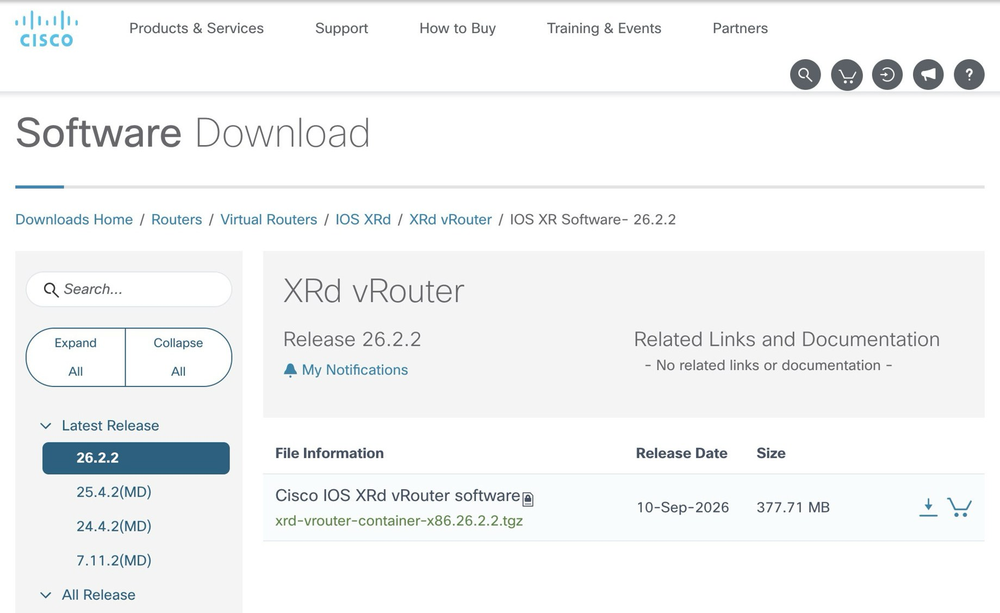

# Add a custom XRd vRouter KVM node in CML

[繁體中文](README.zh-Hant.md) · PDF: [English](docs/XRd_vRouter_CML_KVM_Installation_Guide.pdf) · [繁體中文](docs/XRd_vRouter_CML_KVM_Installation_Guide.zh-Hant.pdf)

This guide gives the procedure for three tasks. Download Cisco XRd vRouter 26.2.2. Build the KVM disk. Add a bootable custom node to Cisco Modeling Labs, CML.

KVM means Kernel-based Virtual Machine. After the installation, add `IOS XRd vRouter (e1000)` to a CML lab. Enter the IOS XR CLI. The CLI shows the management interface and the data plane interfaces.

**Lab use only.** The guest starts the XRd container with `--privileged` and without AppArmor confinement. This is not a production design. See section 10.

The procedure uses the custom nodes from CML 2.10.0 and CML 2.10.1. For each new disk, do the start checks in section 6.

## 1. Installation structure and required files

CML starts one Ubuntu VM for each node. Docker in that VM runs XRd vRouter. XRd vRouter uses the PCI NICs in the VM for the data plane.

```text
CML host
└── KVM guest: xrd-vr-e1000
    ├── Ubuntu 24.04 + Docker
    ├── Cisco XRd vRouter 26.2.2 container
    ├── e1000 NIC 1 -> MgmtEth0/RP0/CPU0/0
    ├── e1000 NIC 2 -> GigabitEthernet0/0/0/0
    ├── e1000 NIC 3 -> GigabitEthernet0/0/0/1
    └── e1000 NIC 4 -> GigabitEthernet0/0/0/2
```

CML needs these three items:

| Item | Value in this guide | Purpose |
|---|---|---|
| Node Definition | `xrd-vr-e1000` | Sets CPU, RAM, NICs, the console and the boot files |
| Image Definition | `xrd-vr-e1000-26-2-2` | Links the disk image to the node definition |
| Disk Image | `xrd-vr-e1000-26-2-2.qcow2` | Contains Ubuntu, Docker, the XRd image and the start service |

The golden disk is the prepared base disk. CML creates one overlay for each node. CML writes the node changes to that overlay. Keep the registered base disk. A change to that disk affects every node that uses it.

Cisco does not supply this custom node definition. Cisco does not support it. Get and use the Cisco software under the Cisco license terms. A CML license does not include a separate XRd vRouter download. This repository supplies scripts and definition files only. Prepare the software archive and the golden disk yourself.

### 1.1 Repository contents

Every path below starts at the repository root, `xrd-vrouter-cml/`.

| File | Purpose |
|---|---|
| [build/build-golden.sh](build/build-golden.sh) | Creates the standalone qcow2 disk on the Linux build host |
| [build/user-data](build/user-data), [build/meta-data](build/meta-data) | Supplies the cloud-init configuration for the build VM |
| [build/setup.sh](build/setup.sh) | Installs the XRd image and the start service |
| [build/stub.sh](build/stub.sh) | Runs `guest-init.sh` from the configuration CD at boot |
| [definitions/xrd-vr-e1000-node.yaml](definitions/xrd-vr-e1000-node.yaml) | Supplies the node definition for import into CML |
| [definitions/xrd-vr-e1000-26-2-2-image.yaml](definitions/xrd-vr-e1000-26-2-2-image.yaml) | Supplies the field values for the image definition |
| [definitions/xrd-vr-vmxnet3-node.yaml](definitions/xrd-vr-vmxnet3-node.yaml), [definitions/xrd-vr-vmxnet3-26-2-2-image.yaml](definitions/xrd-vr-vmxnet3-26-2-2-image.yaml) | Optional variant with vmxnet3 NICs (section 5.5) |
| [examples/](examples) | Three test configurations for the forwarding test (section 6.1) |

The node definition contains `guest-init.sh`. At boot, CML writes three files to the configuration CD. The files are `guest-init.sh`, `first-boot.cfg` and `xrd.env`. The VM runs the script from that CD. The file `build/guest-init.sh` is the same script for review.

### 1.2 Locations and resources

| Location | Task | Requirement |
|---|---|---|
| Workstation | Download the Cisco file, edit the YAML, open the CML UI and copy files | macOS, Windows or Linux |
| Linux build host | Build the qcow2 disk from the Cisco archive | x86-64, KVM, QEMU and access to the Ubuntu repositories |
| CML host | Store the qcow2 disk and run the custom node | Access to `/dev/kvm`, host SSH and `sudo` |
| XR CLI | Confirm the XRd version and the interfaces | Available in the CML console after the node starts |

The build VM uses 4 vCPU and 6144 MiB of RAM. Each completed CML node uses 2 vCPU and 7168 MiB of RAM by default. These values belong to different stages. The first value applies to the build. The second value applies to node operation.

The virtual disk capacity is 32 GiB. The qcow2 file grows with its contents. The build also keeps the Ubuntu cloud image, the XRd archive and the standalone disk. Run `df -h /var/tmp` before the build. Keep free space for that growth.

## 2. Download XRd vRouter from Cisco

**Where: the browser on the workstation.**

1. Open [Cisco Software Download](https://software.cisco.com/download/home/286331238/type/280805694/release/26.2.2). This is a public page that a guest can open. The download needs CCO entitlement.
2. Confirm the path `Routers > Virtual Routers > IOS XRd > XRd vRouter`.
3. Select release `26.2.2` for this guide.
4. Download `xrd-vrouter-container-x86.26.2.2.tgz`.
5. Compare the file name and the size with the details on the download page.
6. Compare the checksum when the page shows one. Use the same algorithm.



Figure 1. The public download page shows release `26.2.2`, the date `10-Sep-2026` and the size `377.71 MB`. Compare these details with the file that you download. Source: the public page at software.cisco.com. © Cisco and/or its affiliates.

The download is the Cisco container archive. A later step extracts the Docker image archive from it. The build loads that archive into the Ubuntu disk.

| Stage | File | Next action |
|---|---|---|
| Cisco download | `xrd-vrouter-container-x86.26.2.2.tgz` | List the contents and extract the archive |
| After extraction | `*.dockerv1.tgz`, with the actual name from the archive | Copy it to `share/` in the build directory |
| Completed build | `standalone.qcow2` | Copy it to the CML drop folder |
| CML registration | `xrd-vr-e1000-26-2-2.qcow2` | Link it to the image definition |

## 3. Prepare the Linux build host

### 3.1 Confirm KVM

**Where: the Linux build host and the CML host. Run the commands once on each host.**

```bash
uname -m
ls -l /dev/kvm
lscpu | grep -o -w -E 'ssse3|sse4_1|sse4_2|pdpe1gb|vmx|svm' | sort -u
```

The expected result shows `x86_64` and `/dev/kvm`. It also shows the CPU flags `ssse3`, `sse4_1` and `sse4_2`. The flag `vmx` or `svm` shows the Intel or AMD virtualization feature.

The scripts in this repository use 1 GiB hugepages. The CPU must provide the `pdpe1gb` flag. The hypervisor must present that flag to the guest VM. When the flag is absent, examine the CPU configuration on the host and on the VM. After the node starts, the console shows `Hugepagesize` as `1048576 kB`. With the default value, `HugePages_Total` is `1`.

When CML runs in an ESXi VM, enable hardware virtualization for that VM. The CML VM can then run nested KVM. When `/dev/kvm` is absent, correct the hypervisor configuration before you continue.

### 3.2 Prepare the build tools

**Where: a dedicated Ubuntu Linux build host.**

```bash
command -v qemu-system-x86_64 qemu-img genisoimage isoinfo timeout
```

When a command is missing, install the packages on that build host:

```bash
sudo apt-get update
sudo apt-get install -y qemu-system-x86 qemu-utils genisoimage
```

A CML host with these tools can also build the disk. Confirm that the host has sufficient resources before the build. For package changes on a CML host, follow its maintenance procedure.

### 3.3 Copy the source files

Copy these items to the home directory of your user on the Linux build host:

- Copy `build/` from this repository to `~/xrd-vrouter-cml/build/`.
- Copy the Cisco download to `~/xrd-vrouter-container-x86.26.2.2.tgz`.
- Download `noble-server-cloudimg-amd64.img` from the [Ubuntu cloud-image directory](https://cloud-images.ubuntu.com/noble/current/). Put the file in the home directory. Compare it with the Ubuntu checksum.

Use SCP or SFTP. Create `~/xrd-vrouter-cml/` on the build host first. Run the next command on the workstation, in the directory that contains `xrd-vrouter-cml/`. Replace `BUILD_USER` and `BUILD_HOST` first:

```bash
scp -r xrd-vrouter-cml/build \
  BUILD_USER@BUILD_HOST:~/xrd-vrouter-cml/
```

Use SCP to copy the other two files to the home directory on the build host.

### 3.4 Create the build directory

**Where: the Linux build host.**

The commands below use the default path `/var/tmp/xrd-vrouter-lab`. When that path already has build data, keep the old data. Select a new empty directory. Use the new path in the later commands and in `WORKDIR`.

```bash
sudo install -d -o "$(id -un)" -g "$(id -gn)" \
  /var/tmp/xrd-vrouter-lab
mkdir -p /var/tmp/xrd-vrouter-lab/src \
  /var/tmp/xrd-vrouter-lab/share \
  /var/tmp/xrd-vrouter-lab/cisco
cp -R ~/xrd-vrouter-cml/build/. /var/tmp/xrd-vrouter-lab/src/
cp ~/noble-server-cloudimg-amd64.img /var/tmp/xrd-vrouter-lab/
```

### 3.5 Extract the Cisco archive

List the archive contents first:

```bash
tar -tzf ~/xrd-vrouter-container-x86.26.2.2.tgz
```

Extract the archive into the new `cisco/` directory:

```bash
tar -xzf ~/xrd-vrouter-container-x86.26.2.2.tgz \
  -C /var/tmp/xrd-vrouter-lab/cisco
find /var/tmp/xrd-vrouter-lab/cisco -type f -name '*.dockerv1.tgz'
```

Confirm that the result includes the Docker image archive for XRd vRouter. Replace `ACTUAL_DOCKERV1_PATH` with the full path from the previous command:

```bash
cp ACTUAL_DOCKERV1_PATH \
  /var/tmp/xrd-vrouter-lab/share/ios-xrd-vrouter-26-2-2.tar.gz
gzip -t /var/tmp/xrd-vrouter-lab/share/ios-xrd-vrouter-26-2-2.tar.gz
```

This copy uses the default archive name for the build script. The build VM assigns the Docker image tag. The build host only needs to run QEMU.

When the search finds no `*.dockerv1.tgz` file, read the README in the archive and its file list. Identify the real Docker image archive before you continue. Do not decide the file purpose from a renamed extension.

The completed directory contains these items:

```text
/var/tmp/xrd-vrouter-lab/
├── noble-server-cloudimg-amd64.img
├── cisco/                  # Extracted Cisco package
├── share/
│   └── ios-xrd-vrouter-26-2-2.tar.gz
└── src/
    ├── build-golden.sh
    ├── user-data
    ├── meta-data
    ├── setup.sh
    └── stub.sh
```

## 4. Build and examine the qcow2 disk

**Where: the Linux build host.**

### 4.1 Run the build

```bash
sudo bash /var/tmp/xrd-vrouter-lab/src/build-golden.sh
```

The script creates a 32 GiB qcow2 overlay. It then starts the build VM. The VM installs Docker. The VM loads the XRd image. The VM configures the start service. The VM then stops. The VM needs access to the Ubuntu package repository through the QEMU network.

Set the parameters for a different build path or archive name. This script writes `XRD_ARCHIVE` and `XRD_TAG` to a shell configuration file. Use only letters, digits, periods, underscores and hyphens in the archive name. Use a valid Docker tag. Do not use spaces or shell special characters in either value. For the first installation, use these default values:

```bash
sudo WORKDIR=/var/tmp/xrd-vrouter-lab \
  XRD_ARCHIVE=ios-xrd-vrouter-26-2-2.tar.gz \
  XRD_TAG=ios-xrd-vrouter:26-2-2 \
  bash /var/tmp/xrd-vrouter-lab/src/build-golden.sh
```

| Parameter | Meaning |
|---|---|
| `WORKDIR` | Build directory with the cloud image, `share/` and `src/` |
| `XRD_ARCHIVE` | File name of the Docker image archive in `share/` |
| `XRD_TAG` | Docker tag that the VM uses to run XRd |

The script waits for the build VM for a maximum of 2700 seconds. Read the progress from another terminal:

```bash
sudo tail -f /var/tmp/xrd-vrouter-lab/serial.log
```

After the installer mounts the shared directory, also read `/var/tmp/xrd-vrouter-lab/share/setup.log`.

### 4.2 Confirm the build result

A successful build meets all of these conditions:

- `serial.log` contains `XRD_GOLDEN_READY`.
- The build command prints `QEMU_RC:0` and `GOLDEN_OK`.
- The command exits normally and creates `standalone.qcow2` with its SHA-256 value.

```bash
sudo grep XRD_GOLDEN_READY /var/tmp/xrd-vrouter-lab/serial.log
sudo qemu-img info /var/tmp/xrd-vrouter-lab/standalone.qcow2
sudo qemu-img check /var/tmp/xrd-vrouter-lab/standalone.qcow2
sudo sha256sum /var/tmp/xrd-vrouter-lab/standalone.qcow2
```

`qemu-img info` shows the qcow2 format and no `backing file`. `qemu-img check` reports no errors. Record the SHA-256 value. Use it later to compare the file on the CML host.

Upload `standalone.qcow2`. The file `golden.qcow2` in the build directory still depends on the Ubuntu cloud image. The command `qemu-img convert` writes the full disk contents to `standalone.qcow2`.

When the build prints `GOLDEN_FAIL` or an existing-file message, keep `serial.log` and `share/setup.log`. Correct the cause, and then use a new build directory. The script does not replace an existing `seed.iso`, `golden.qcow2`, `standalone.qcow2` or `serial.log`.

## 5. Register the custom node in CML

Import the node definition first. Create the image definition second. The two IDs must match section 1.

### 5.1 Prepare the node definition

**Where: a text editor on the workstation.**

1. Open a working copy of `definitions/xrd-vr-e1000-node.yaml`.
2. Find `username lab` in `first-boot.cfg`.
3. Replace `CHANGE_ME_BEFORE_IMPORT` in `secret 0` with your password.
4. Save the working copy.
5. Keep the YAML indentation and the complete file structure.

The value after `secret 0` is plain text. The edited YAML therefore contains the password. Store that file safely. Remove the real password before you share the template.

You can also enter a hashed secret to keep the plain text out of the YAML. Create the hash on a Linux host with `openssl passwd -6`. Enter it as `secret 10 <hash>`. After the first start, examine the entry with `show running-config` and test the login.

The definition file sets the fields below. Keep these default values for the first installation:

| Field | Value or purpose |
|---|---|
| `id` | `xrd-vr-e1000` |
| `sim.linux_native.libvirt_domain_driver` | `kvm` |
| `sim.linux_native.driver` | `iosxrv9000`, for the CML console and configuration integration |
| `sim.linux_native.disk_driver` | `virtio` |
| `sim.linux_native.nic_driver` | `e1000` |
| `sim.linux_native.cpus` | `2` |
| `sim.linux_native.ram` | `7168` MiB |
| `boot.timeout` | `1800` seconds |
| `device.interfaces.default_count` | `4`, including the management interface |
| `device.interfaces.min_count` | `2`, for management and one data plane interface |
| `inherited` | Keep the complete CPU, RAM and related inheritance settings |

The node definition also contains three provisioning files:

| File | Editable state in CML | Purpose |
|---|---|---|
| `first-boot.cfg` | Editable | Sets the IOS XR account and the first configuration |
| `xrd.env` | Editable | Sets the XRd environment variables |
| `guest-init.sh` | Not editable | Identifies the PCI NICs and starts XRd at VM boot |

Keep this default content in `xrd.env`:

```text
XR_VROUTER_DP_HUGEPAGE_MB=1024
XR_VROUTER_DP_MAIN_TUNE=100,250,500,80,100
```

### 5.2 Import the node definition

**Where: the CML web UI, with an administrator account.**

1. Open **Tools → Node and Image Definitions**.
2. Select **Node Definitions**.
3. Use the import function and upload the complete YAML with your password.
4. Confirm that the list shows `IOS XRd vRouter (e1000)` with the ID `xrd-vr-e1000`.

When a definition with the same ID exists, confirm whether a lab uses it. For an existing installation, examine the definition and its image link. Before you change a shared definition, identify the affected nodes.

### 5.3 Copy the qcow2 file to CML

Copy `standalone.qcow2` to the home directory of the CML administrator. Run the example below in the shell of the normal build account on the build host. Replace `CML_USER` and `CML_HOST` first.

The build runs as root. Give this new output file to the build account. Then copy the file with the SSH configuration of that account:

```bash
sudo chown "$(id -un):$(id -gn)" \
  /var/tmp/xrd-vrouter-lab/standalone.qcow2
scp /var/tmp/xrd-vrouter-lab/standalone.qcow2 \
  CML_USER@CML_HOST:~/standalone.qcow2
```

Open an SSH session on the CML host. Confirm that the destination file and the image directory do not exist:

```bash
sudo ls -ld /var/local/virl2/dropfolder
sudo test ! -e \
  /var/local/virl2/dropfolder/xrd-vr-e1000-26-2-2.qcow2 \
  && echo DROPFILE_FREE
sudo test ! -e \
  /var/lib/libvirt/images/virl-base-images/xrd-vr-e1000-26-2-2 \
  && echo IMAGE_DIRECTORY_FREE
```

Copy the disk only after `DROPFILE_FREE` and `IMAGE_DIRECTORY_FREE` both appear. When either marker is absent, identify the purpose of the existing file first.

```bash
sudo install -o virl2 -g virl2 -m 664 ~/standalone.qcow2 \
  /var/local/virl2/dropfolder/xrd-vr-e1000-26-2-2.qcow2
sudo sha256sum \
  /var/local/virl2/dropfolder/xrd-vr-e1000-26-2-2.qcow2
```

The SHA-256 value must match `standalone.qcow2` on the build host. This step only copies the disk to the drop folder. CML creates the final image directory.

### 5.4 Create the image definition

**Where: the CML web UI.**

1. Return to **Tools → Node and Image Definitions**.
2. Find `xrd-vr-e1000-26-2-2.qcow2` in the available images from the drop folder. Refresh the page when the list is not current.
3. Create the image definition for that disk. Enter the values in the table. Button names can differ between CML versions. Compare the fields and the linked values.
4. After you save the definition, confirm its link to `xrd-vr-e1000`.

| Field | Value |
|---|---|
| ID | `xrd-vr-e1000-26-2-2` |
| Label | `XRd vRouter 26.2.2 (e1000)` |
| Node Definition | `xrd-vr-e1000` |
| Disk Image | `xrd-vr-e1000-26-2-2.qcow2` |

The file `definitions/xrd-vr-e1000-26-2-2-image.yaml` contains the same field values. The previous step must still copy the disk file to CML.

After a successful save, CML moves the disk from the drop folder to the final directory. Examine the result on the CML host:

```bash
sudo ls -lh \
  /var/lib/libvirt/images/virl-base-images/xrd-vr-e1000-26-2-2/
sudo sha256sum \
  /var/lib/libvirt/images/virl-base-images/xrd-vr-e1000-26-2-2/xrd-vr-e1000-26-2-2.qcow2
```

The image registration is complete when the disk exists and the two SHA-256 values match.

### 5.5 Optional: the vmxnet3 variant

The e1000 variant is the default in this guide. The repository also has a variant with vmxnet3 NICs. Use it only when you need it.

1. Import `definitions/xrd-vr-vmxnet3-node.yaml` after you replace the password placeholder.
2. Copy `standalone.qcow2` again, with the file name `xrd-vr-vmxnet3-26-2-2.qcow2`. Use the same steps as in section 5.3.
3. Create the image definition `xrd-vr-vmxnet3-26-2-2` for the node definition `xrd-vr-vmxnet3`.

The data plane interfaces of this variant have the names `TenGigE0/0/0/N`, not `GigabitEthernet0/0/0/N`. Change the interface names in every configuration and link description, including the files in `examples/`. A 10G interface has a higher default OSPF cost than a 1G interface. Add `bandwidth 1000000` to an interface when you need the cost of a 1G interface.

## 6. Create a node and confirm the start

**Where: the CML web UI and the node console.**

1. Create a lab only for this installation check.
2. Add `IOS XRd vRouter (e1000)`.
3. Confirm that the node uses the image definition `xrd-vr-e1000-26-2-2`.
4. Keep 2 vCPU, 7168 MiB of RAM and the default four interfaces.
5. In the node settings, confirm the account in `first-boot.cfg` and the default values in `xrd.env`.
6. Start the node and open the first serial console.
7. Wait until the XR CLI is available. Enter it with the `lab` account and the password from the earlier step.

You can confirm the start of one node without network links. The node still needs the management interface and at least one data plane interface. The start script must identify those interfaces.

The console shows these messages in order. `<netdev>` and `<PCI address>` are the detected values:

```text
XRD_GUEST_INIT_START kvm
XRD_GUEST_NOIOMMU Y
XRD_GUEST_ENV XR_VROUTER_DP_HUGEPAGE_MB=1024 ...
XRD_GUEST_INIT_RUN mgmt=<netdev>(<PCI address>) data=pci:<PCI address>
ios con0/RP0/CPU0 is now available
```

Use two results to decide that the node is ready. The console shows `is now available`, and you can enter the XR CLI. The CML state `BOOTED` can appear earlier. Continue to read the console. The start time depends on the host load.

Run these commands in the **XR CLI**:

```text
show version
show ipv4 interface brief
```

The expected results are:

- `show version` shows `Cisco IOS XR Software, Version 26.2.2 LNT`.
- The interface list includes `MgmtEth0/RP0/CPU0/0`.
- With the default four interfaces, the list includes `GigabitEthernet0/0/0/0` through `GigabitEthernet0/0/0/2`.

The interfaces have no IP addresses at this point. An interface can also show the down state because its default state is shutdown. Configure those items later in the lab. After these checks, the custom node is ready for use in CML.

### 6.1 Optional: test forwarding with the examples

**Where: the CML web UI and the node consoles.**

This test uses two XRd nodes and one IOS node. It checks the data plane, LLDP and CDP.

1. Create a lab with the nodes `VR1` and `VR2` (`IOS XRd vRouter (e1000)`) and the node `IOS`.
2. Connect `VR1` GigabitEthernet0/0/0/0 to `VR2` GigabitEthernet0/0/0/0.
3. Connect `VR1` GigabitEthernet0/0/0/1 to `IOS` GigabitEthernet0/0.
4. Load `examples/VR1.cfg`, `examples/VR2.cfg` and `examples/IOS.cfg` in the three nodes. Replace `CHANGE_ME_BEFORE_IMPORT` first.
5. Start the nodes and wait for the XR CLI.

Run these commands on `VR1`:

```text
ping 10.10.10.2
ping 10.10.20.2
show lldp neighbors
show cdp neighbors
```

Both pings must succeed. `VR1` must list `VR2` in LLDP and CDP, and the `IOS` node in CDP. On `VR2`, `ping 10.10.10.1` must also succeed.

## 7. Initial configuration and normal use

### 7.1 Configuration storage

The node disk stores the XR configuration in the Docker volume `xr-storage`. Configuration that you commit in the XR CLI remains after CML stop and start.

The file `first-boot.cfg` applies to the first initialization. For a node with stored configuration, make later changes in the XR CLI. `commit` each change. Create a new node to test a new Day-0 template. The CML wipe operation removes the node overlay and its XR configuration. CML then initializes the node again from the base disk. Save a copy of the required configuration before a wipe.

### 7.2 Hugepages and environment variables

The build script reserves three 1 GiB hugepages in the GRUB configuration of the guest VM. At node start, `guest-init.sh` reads `XR_VROUTER_DP_HUGEPAGE_MB=1024` and releases the unused pages. The default result keeps one page. The 7168 MiB RAM value includes these hugepages.

Scripts inside the guest adjust the hugepage and socket sysctl values. Keep the default values, and keep the existing settings on the CML host.

Two optional lines in `xrd.env` control the guest, not XRd. `GUEST_SOCKET_SYSCTL=0` skips the socket sysctl values. `GUEST_THP=never`, `madvise` or `always` sets the transparent hugepages in the guest. The start script also passes these lines to the container. We did not examine how XRd handles them.

In XRd 26.2.2, `XR_VROUTER_DP_MAIN_TUNE` needs five values. When you add an environment variable, compare its name with that XRd release. Read the console for `Invalid environment variable(s)`.

### 7.3 Move the installation to another CML host

The other CML host needs the same node definition, image definition and qcow2 file. An exported lab YAML contains the lab nodes and their configuration. It does not replace those three installation items.

Copy the built base qcow2 file and compare the SHA-256 values. Then repeat sections 5 and 6 on the target CML host. Each host needs working KVM. Follow the software license terms.

For a new XRd release, use a new build directory, disk file name and image definition ID. Existing nodes depend on their original base disk. Keep that disk until every dependent node uses the new image.

## 8. Installation fault isolation

| Symptom | Where to examine and the cause clue | Action |
|---|---|---|
| `/dev/kvm` does not exist | Linux build host or CML host. The VM has no virtualization feature. | Confirm CPU virtualization and nested virtualization in the hypervisor. |
| The 1 GiB hugepage path is absent or allocation fails | Console, the `pdpe1gb` CPU flag and guest memory. | Confirm that the hypervisor presents the flag. Confirm 7168 MiB RAM and the default variable. |
| No `*.dockerv1.tgz` file | File list in the Cisco download archive. | Confirm the product and release. Read the repository README and identify the Docker image archive. |
| `STOP: existing build artifact` | The build directory already has a disk, ISO or log. | Keep the data and use a new build directory. |
| `GOLDEN_FAIL` or a build timeout | `serial.log` and `share/setup.log`. | Examine repository access, disk space and `docker load` errors. Correct the cause and build again. |
| Image load or tag assignment fails | `Loaded image:` and the Docker error in `setup.log`. | Confirm that the input is a Docker image archive and that its image maps to `XRD_TAG`. |
| `Failed to create folder` during image creation | The final image directory already exists. | Identify its link to an existing image definition. Remove only installation residue that no node uses. |
| CML does not list the qcow2 file | File name, owner and permissions in the drop folder. | Repeat section 5.3. Confirm owner `virl2:virl2`, mode `664`, and refresh the page. |
| CML cannot create the node | The node definition is incomplete or has no `inherited` section. | Compare the repository YAML again. Keep every field and the correct indentation. |
| `XRD_GUEST_INIT_FAIL` | The text after that marker in the console. | Confirm the management NIC, one data plane NIC and the three provisioning files. |
| `Invalid environment variable(s)` | `xrd.env` on the node. | Restore the two default variables from this guide. Then examine each added variable. |
| `unsupported PCI IDs` | `nic_driver` in the node definition. | Use the `e1000` definition from this repository. |
| `XRd is expected to require 5Gi of RAM` | Node RAM and the hugepage setting in the guest. | Confirm 7168 MiB RAM and the default `XR_VROUTER_DP_HUGEPAGE_MB=1024`. |
| No XR CLI after `BOOTED` | Guest and XRd start messages in the console. | Wait for `is now available`. When the messages stop or repeat, record the first error. |
| Login data stays old after an edit to `first-boot.cfg` | The node already has stored configuration in `xr-storage`. | Enter with the original account, or create a new node for the new initial configuration. |

## 9. Completion and sources

The custom node is ready when all of these results are true:

- CML has the node definition `xrd-vr-e1000`.
- CML has the image definition `xrd-vr-e1000-26-2-2`, with the correct disk.
- The qcow2 SHA-256 value matches on the build host and in the final CML directory.
- The new node starts, and the selected account can enter the XR CLI.
- The XR CLI shows version 26.2.2, the management interface and the expected data plane interface names.

The installation values come from `build/` and `definitions/` in this repository.

References:

- [Cisco Software Download: XRd vRouter 26.2.2](https://software.cisco.com/download/home/286331238/type/280805694/release/26.2.2)
- [Cisco CML: Preparing a Custom Image](https://developer.cisco.com/docs/modeling-labs/preparing-a-custom-image/)
- [Ubuntu 24.04 cloud image](https://cloud-images.ubuntu.com/noble/current/)
- [Cisco IOS XRd Data Sheet](https://www.cisco.com/c/en/us/products/collateral/routers/ios-xrd/ios-xrd-ds.html)
- [ios-xr/xrd-tools](https://github.com/ios-xr/xrd-tools)

## 10. Use, license and trademarks

- **Lab use only.** The guest starts the XRd container with `--privileged` and without AppArmor confinement. Use this node in a lab. Do not use it in production.
- **No change to XRd.** The scripts load the Cisco XRd image without a change. They add a Linux guest, a start script and CML definition files around it. This repository has no Cisco software and no disk image.
- **Support.** This is an independent work. Cisco does not support it. We do not provide individual support.
- **License.** The scripts, the definition files and the examples use the MIT License (`LICENSE`). The MIT License does not cover Cisco software, Cisco trademarks or Cisco documents. The documents (the README files and the PDF files) use CC BY-NC-ND 4.0 (`LICENSE-docs`). Copyright 2026 quintus-lab.
- **Trademarks.** Cisco, Cisco Modeling Labs, CML, IOS XR and XRd are trademarks or registered trademarks of Cisco and/or its affiliates in the US and other countries. Other names belong to their owners. This work is not affiliated with Cisco.
